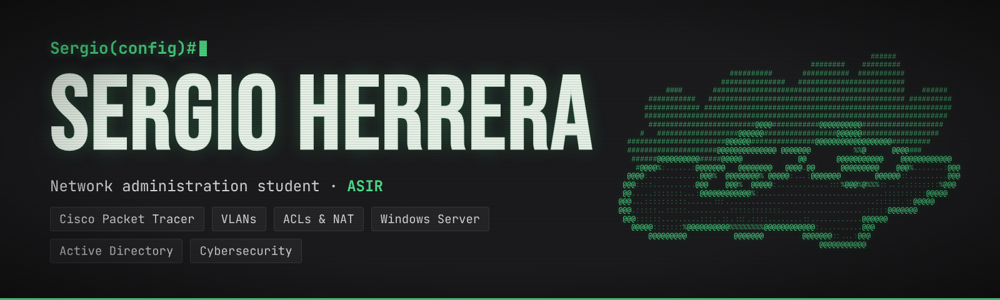

  

  
  
  

# Hola, soy Sergio Herrera

**Estudiante de ASIR** · Redes y ciberseguridad · Comunidad de Madrid

Soy estudiante de 2.º de ASIR, orientado a las redes e interesado en la ciberseguridad. Actualmente preparo la certificación CCNA de Cisco y cuento con una base sólida en administración de sistemas Windows Server y Linux. Soy resolutivo y analítico: cuando algo falla, intento entender por qué hasta dar con la solución.

---

### Ahora mismo

- Estudiando **ASIR** (Administración de Sistemas Informáticos en Red) en Digitech FP
- Haciendo cursos de **Cisco Networking Academy**: CCNA 1 e Introducción a la Ciberseguridad
- Buscando prácticas o un puesto junior en redes y sistemas

### Habilidades

| Área | Herramientas y tecnologías |
|---|---|
| **Redes** | Routers y switches Cisco, VLAN, enrutamiento estático, RIP y OSPF, ACLs, NAT/PAT, SSH, Cisco Packet Tracer |
| **Sistemas** | Windows Server, Active Directory, Linux, máquinas virtuales |
| **Ciberseguridad** | Firewalls Cisco ASA, VPN, prácticas de Man-in-the-Middle, fundamentos de criptografía, Wireshark |
| **Bases de datos** | MySQL, Oracle |
| **Hardware** | Montaje, mantenimiento y reparación de equipos |

### Proyectos

- **[OCULAR](https://github.com/Serggg22/ocular):** proyecto de concepto: web de galería para una estudiante de diseño
- **[Proyecto web final 1º ASIR](https://github.com/Serggg22/Pr-ctica-LM):** concepto de portfolio personal en HTML, CSS y JavaScript
- **Proyectos de redes:** VPN con Cisco ASA y diseño de la red de una empresa, disponibles para descargar en mi [portfolio](https://serggg22.github.io)

### Formación

- **Grado Superior, ASIR** · Digitech FP · 2025 – actualidad
- **Grado Medio, SMR** (Sistemas Microinformáticos y Redes) · Digitech FP · 2023 – 2025

### Experiencia

- **Técnico de soporte informático (prácticas)** · Academia Butarque · marzo – junio 2025

### Idiomas

Español · Inglés B2

### Contacto

- **Correo:** [sergioherreragarcia1@gmail.com](mailto:sergioherreragarcia1@gmail.com)
- **LinkedIn:** [sergio-herrera-garcia](https://www.linkedin.com/in/sergio-herrera-garcia)
- **Portfolio:** [serggg22.github.io](https://serggg22.github.io)

*Abierto a prácticas y puestos junior de redes y sistemas, con disponibilidad total.*
